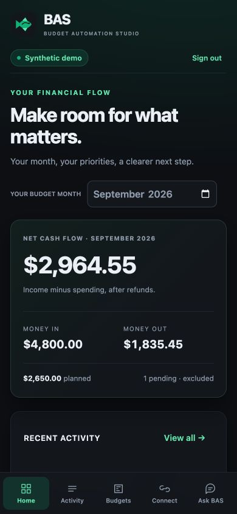

# Release verification

## Reliability repair — 2026-10-12

- `npm test`: 85 passing tests. New coverage verifies distinct identical-content provider transactions, replay, malformed/duplicate investment responses, missing/foreign values, last-successful timestamps, valid zero balances and cancellation of obsolete reads.
- Synthetic Chrome acceptance: delayed month results cannot replace the selected month; old authorization failures cannot sign out a newer view; logout cancels pending state reads; failures hide outdated totals and expose a working Retry button.
- Five main destinations at 320, 390, 768 and 1280px: 20 page/viewport checks, no document overflow or captured page errors. Dark Home and failure-state screenshots were manually reviewed and remain temporary test artifacts.
- Release gates: `npm run check:format`, `npm run check:release`, dependency advisory check, Gitleaks and manual review of every changed public file. CI results are recorded separately in GitHub Actions.
- SDK 12.2.22 updates Axios to 1.20.0; `npm audit --omit=dev --audit-level=high` reports zero known vulnerabilities. Mocked transport checks exercise the real SDK in both personal and commercial authentication modes, preserving the timeout and redirect policy. This does not establish live-provider acceptance.

Run the standard setup commands in [SETUP](SETUP.md), then the regression and release commands above. The optional browser check requires an existing Playwright installation and Google Chrome:

```sh
node test/browser-acceptance.mjs
```

Set `PLAYWRIGHT_MODULE` to an existing Playwright module if it is not resolvable from the checkout. `BAS_TEST_OUTPUT` optionally selects the temporary screenshot directory. The script uses an in-memory database, explicit demo-only configuration, invented fixtures and an ephemeral loopback port. It does not load `.env`, connect a provider or use personal account data. It blocks external browser requests. Restricted runners must permit local loopback binding and launching Chrome. Playwright is optional validation tooling, not an added runtime dependency.

No new environment variables or schema changes are required by this release. A valid zero investment value replaces the previous value; a missing/foreign-currency value preserves it as stale, including its original currency and successful-sync timestamp. An account with no prior valid value remains unavailable. UI Retry reloads local application state; it does not trigger a provider sync or AI call. These checks do not validate live bank/broker eligibility, hosted deployment, populated legacy editor workflows or physical phones.

## Dark mobile update — 2026-09-11

- All 35 regression tests pass locally, including a new manifest/icon HTTP test.
- Manifest uses standalone display, scoped local routes, dark launch colors and 192/512px icons; the Apple touch icon is 180px. HTTP tests verify PNG signatures/dimensions and no-store responses.
- Dark screenshots cover Overview, Budgets, Transactions, Assistant and Connections at 390px phone width. All five views were also checked at 375px with no horizontal overflow. The README leads with the mobile view.
- Installation instructions are available on the login and Connections screens, with matching iPhone/Android steps and official-source links in SETUP.md.
- No service worker, offline financial cache, public listener or change to authentication was introduced. Physical-phone installation still requires a secure remote deployment and has not been tested.

## Initial v0.1.0 verification — 2026-09-11

Validation used a new standalone source tree, a synthetic demo database and mocked provider responses. The private application's source history, configuration, databases, exports and deployment scripts are not part of this release.

| Check | Evidence |
| --- | --- |
| Regression tests | `npm test`: 34 tests passing locally on Node 24.10.0 |
| Dependency advisories | `npm audit --omit=dev`: zero known vulnerabilities at the time checked |
| Source formatting | `npm run check:format` |
| Secret scan | Gitleaks 8.30.1: no leaks found in the staged release diff |
| Release content | `npm run check:release`, plus manual source/asset review |
| Desktop UI | Dashboard checked at 1024px and 1440px widths |
| Tablet UI | Dashboard checked at 768px width |
| Mobile UI | Dashboard, connection states, transaction search and entry checked at 375px width |
| Persistence | Changed a demo budget through the browser, verified updated values, then restored its original limit |
| Manual entry | Submitted a synthetic transaction through the mobile form and found it in the selected month |
| Assistant | Deterministic answer matched dashboard/category totals without an AI provider |
| Overflow | Document width matched viewport at 375, 768, 1024 and 1440px |
| Browser diagnostics | No captured console errors or warnings after final dashboard reload |



[Dark desktop reference](dashboard.jpg)

## Regression coverage

- Exact decimal-to-cent input, invalid dates and unsupported currencies.
- Income reversals, expense refunds, transfers, pending/removed exclusions, category budgets and review counts.
- AES-GCM tamper detection, wrong-key rejection and connection-context binding.
- Personal configuration validation and unconditional demo-provider disabling.
- SQLite batch rollback and idempotent synthetic seed.
- Plaid idempotent upserts/removals, later-page failure rollback, pagination-mutation restart, currency rejection and preservation of user categories.
- Conservative treatment of loan payments and provider transfer labels.
- SnapTrade auth-mode construction, no Personal user registration, read-only portal requests, portal-host validation, missing/foreign values and stale-account preservation.
- AI context allowlisting, deterministic offline summaries and rejection of cloud-labeled model names.
- HTTP session requirements, cookie properties, logout, Host/Origin checks, login throttling, content limits and private-file protection.

## What remains unverified

No real Plaid item was connected, no SnapTrade financial account was accessed, and no local or hosted model inference was run. Adapter tests use synthetic fixtures. These tests cannot validate provider account eligibility, billing, API approval, institution-specific OAuth, mobile provider redirects, or actual model quality.

Screenshots use a browser viewport rather than a physical phone. There is no native app build, app-store submission, public live-data deployment, security certification, penetration test or multi-user acceptance claim. Cross-platform CI results are available in the repository's Actions tab after publication; this local record does not imply those jobs already ran.

Advisory results are time-sensitive. Content pattern checks are partial evidence and do not prove the absence of every possible private datum or vulnerability. Review changes and rerun checks for each release.

## Emerald/slate styling and paired development — 2026-09-11

Matched dark background, surfaces, emerald accents, system typography, cards and tabular numbers to the companion design language. Refreshed five 390x844 mobile screenshots and the 1440x1150 desktop overview, all from the invented demo. Reviewed every screen visually; the mobile Connections document width equals its 390px viewport. Icons and manifest use the matching dark background.

35 tests pass, including the HTTP manifest/icon checks. Formatting and release-content checks pass. HTTP tests require permission to bind ephemeral loopback ports in restricted environments. No real accounts, remote hosting or physical-phone installation was used in this validation.

## BAS public UI and identity — 2026-09-11

Updated the real app name, original vector fish mark, install icons, login, navigation, page hierarchy and cash-flow card. All five runtime destinations fit 360px and 390px viewports without document overflow. Captured new dark 390×844 mobile screenshots and a 1440×1000 desktop reference from an isolated synthetic database with providers disabled. Rebranded the design preview and its three screenshots separately. Browser diagnostics returned no warnings or errors.

The 35 regression tests and formatting checks passed after the runtime changes. Existing accounting/provider behavior is unchanged. Home-screen icons were rendered from the original SVG at 180, 192 and 512px. These are browser checks; physical-phone installation and the larger overhaul/history plan remain separate work.

## Paired private UI release

Added a public chat keyboard enhancement using feature-detected VisualViewport and focus events. Formatting and all 35 regression tests pass. The private companion now uses the shared mobile presentation with its own navigation and native modal. Its live application verification is recorded privately; no personal data, deployment paths or screenshots are included here. Physical-phone keyboard testing remains pending.

## Brand foundation — 2026-10-27

- Node 24.10.0: all 95 regression tests pass. Formatting passes, including the new static site. `npm run check:site` verifies 23 local references, one page heading per document, no scripts/frames/forms and exact original-fish preservation. `npm ci --ignore-scripts` reported zero known dependency vulnerabilities.
- The static product page was inspected at 320, 375, 768, 1024 and 1440px with no document overflow. Its illustrative financial panel uses invented figures and is explicitly labeled. Both site SVG images loaded in the browser. The local-demo action reaches the setup section and exposes a complete copyable clone command.
- The visual brand guide and horizontal lockup were inspected at desktop width. The app entrance and logged-in synthetic Home were inspected at 375 and 1440px; the compact brand fits its sidebar and no document overflow was observed. This is browser review, not physical-phone acceptance.
- The real app review used a separate demo process with an empty inherited environment except the executable path and explicit demo mode/port. No provider credentials, personal settings or financial data were loaded.
- Release-content and credential-pattern scanning cover the staged source and working tree; manual review covers all new copy, SVG assets and invented figures. No public screenshot, database, secret, private endpoint or private history is included. Source publication is for review; BAS hosting and a public hostname remain unconfigured.

Reproduce: `npm ci --ignore-scripts`, `npm test`, `npm run check:format`, `npm run check:site`, `npm run check:release`. Preview with `npm run preview:site`; run the separate synthetic application with `npm start`. Stop owned preview processes after review.

## Applied branding and static release — 2026-10-27

The owner requested applying the prepared changes. The branded app entrance, consistent dashboard/Activity/Budgets hierarchy and wider transaction search are implemented without changing calculations or provider behavior. All 98 tests pass, including marketing-artifact privacy, explicit deployment opt-in/account checks and rejection of unexpected domain routes. Formatting, 36 local site references and a 12-file static build pass.

Home, Activity and Budgets were checked at actual 320/390/768/1280px browser widths without document overflow. The desktop app entrance and the real-screen product tour were visually inspected. Four public JPEGs are unmodified native browser captures of a separate synthetic demo: Home, Activity, Budgets and phone Home. All amounts, dates and transaction descriptions in them are invented demo fixtures. No personal environment was loaded; no provider was connected.

Release-content/credential-pattern scanning and manual review include the exact four approved JPEG paths. The static artifact contains no app server, database, environment file, provider key or authenticated API. Source publication, static marketing hosting and an adopter’s self-hosted finance runtime are separate release states. Cloudflare publishing and HTTP evidence are recorded in the brand guide after verification.
