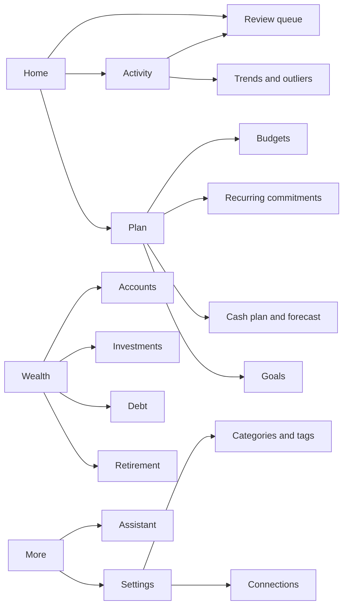

# BAS platform overhaul

Design proposal, 2026-11-14. This package contains three Home studies and a plan for the whole platform. It changes no financial behavior, runtime screen, database or deployment. Every displayed amount is invented. The three concepts use the same study navigation so Home directions can be judged on the same terms. That navigation includes planned capabilities and is not a statement of current BAS runtime support. The navigation below is a separate proposal.

Open [the comparison](platform-directions.html), [A: daily overview](platform-a.html), [B: spending first](platform-b.html), or [C: wealth first](platform-c.html). Phone comparison: [mobile board](platform-directions-mobile.html).

## Recommendation

My recommendation is A. This is a judgment about the feature mix: reviewing transactions, protecting upcoming cash, funding goals and examining wealth all need a visible entry. A puts review and the monthly budget ahead of detailed analytics. B gives the most space to spending. C gives the most space to net worth.

The main redesign is how work is grouped and which decision appears first. Retain the emerald/slate system, system font, exact financial labels and existing capabilities. Give each screen a clear primary task, use rows for related records, and reserve large charts for screens where examining the chart is the task. Keep explanations in disclosures beside the relevant number.

## What the current source establishes

The personal application has Home cash-flow charts and planning, a dedicated review queue, transaction search/editing, categories and tags, refunds and receipts, shared-expense preparation/confirmation, four analytics tabs, wealth/accounts/holdings/debt/retirement, Goals, and saved assistant conversations. Goals and basic encrypted server history are already source capabilities; the September design ledger's blanket "planned" status is historical. Full redesign, advanced conversation features and physical-phone acceptance are separate.

BAS has its own Home, transactions/review, budgets, Goals, connections, investment account values, manual-input cash planning and saved assistant conversations. Its current cash-flow total and account-value coverage differ from the personal application's. A concept drawing of an advanced feature does not implement it in BAS.

The previous [feature contracts](UI-FUNCTIONS.md), [chart contracts](CHARTS.md), [Goals behavior](../GOALS.md), and [history behavior](../CHAT-HISTORY.md) remain the detailed requirements. This proposal adds organization and priorities; it does not replace money, authorization or recovery rules.

## Whole-platform navigation

My proposed desktop navigation is Home, Review, Activity, Plan, Wealth and Assistant. Settings holds Categories & tags, Connections and Appearance. Review retains its pending count. Plan exposes Budgets, Upcoming, Cash plan and Goals as named sections; wealth exposes Accounts, Investments, Debt and Retirement.

My proposed phone navigation is Home, Activity, Plan, Wealth and More. The Home review card and Activity's "Needs review" tab both open the focused queue in one tap. The cost is losing the current separate Review bottom tab; validate that tradeoff before changing it. Assistant remains a labeled header entry and a full-screen destination. More exposes Insights, Assistant and Settings by name. Keep explicit Back actions on deeper screens and restore period, filters and scroll when returning.

Grouping these destinations is our design judgment. It is not a claim that a reference product uses this exact architecture. Existing URLs and provider callback paths must continue to resolve during implementation.

## Screen-by-screen changes

| Destination | Proposed screen and primary task | Functionality that must survive | BAS adaptation and remaining gap |
| --- | --- | --- | --- |
| Home | Compact period measures; review and budget together; planning and goal summaries before historical charts | Period selection, liquid cash-flow bridge, savings explanation, all categories including remainder, merchant and comparison drilldowns, Goals, paycheck plan and forecast | Use BAS's own cash-flow calculation. Its manual cash plan is available; bank-fed cash flow and advanced charts remain planned. Never label its simpler total "liquid cash flow" without an equivalent calculation |
| Review | Queue beside one selected purchase on desktop; one purchase per phone screen; one visible approval action | Edit category/account/description, exact splits, refund suggestion, eligible bulk approval, reject, sharing prepare/commit/uncertain-state recovery | Existing local review remains; advanced split/refund and external-sharing workflows need independent generic adapters and tests |
| Activity | Date-grouped rows; search and active filters above results; desktop detail drawer and mobile full-screen detail | Filter totals and bounded pages, manual entry/edit/delete, tags, receipts, refund-original links and account lookup | Keep current transaction CRUD/review/bounded state. Receipts, tags, refund relationships and richer filters must be separately assessed and implemented; they are not closed by these mockups |
| Budgets | One row per category showing target, spent and remaining; month control stays visible | Budget targets, deletion/reset, totals, pace and exact values | Existing monthly budget capability; preserve BAS category identifiers and currency. Grouping under Plan is presentation work |
| Upcoming | Dated list first, optional calendar; commitment type and estimated amount visible | Recurring detection, must-pay/flexible/ignored classifications and user overrides | BAS accepts dated bills in manual cash plans; detection/classification and recurring management remain gaps |
| Cash plan | Projected balance, lowest headroom and dated bills; assumptions next to the scenario controls | Balance freshness, reserves, buffer, typical spending toggle, no-further-pay baseline, explicit hypothetical income and shortfall warnings | Existing provider-neutral manual preview is the starting point. Connected balance and recurring adapters remain gaps; a missing observation must stay unavailable |
| Goals | Purchase and long-term views; progress, priority and monthly contribution on each row; funding setup in its own screen | Combined monthly limit, virtual reservations, release/reassign, waiting states, purchase payment holds, completion/archive/restore, audit and idempotent recovery | Existing ledger and workflows remain; use adopter-confirmed cash observations rather than pretend bank balance access |
| Wealth overview | Net worth and its assets/debts equation first; current worth definition kept separate; accounts below | History, snapshots, account/liability CRUD, freshness, manual/provider distinction and exact values | Current investment values are available. A combined net-worth calculation, liabilities and comparable history are not established by the current BAS runtime |
| Investments | Holdings table/list and allocation, with source observation dates | Position values, weights, incomplete/stale sync and read-only connection controls | Account values are available; position/activity analytics remain a separate port |
| Debt and retirement | Separate scenario screens; inputs beside results; explicit Save for persisted assumptions | Extra-payment scenarios, payoff chart, retirement settings and projection; no implied execution | Dedicated calculation and settings contracts remain gaps; figures in the design are examples only |
| Insights | Trends, year comparisons, category/merchant changes and unusual purchases; click/tap opens the matching activity filter | All 12 existing chart contracts, accessible exact-value alternatives, selected periods, missing/stale states and bounded queries | Budget comparisons use existing data; advanced trend/outlier/chart engines remain planned |
| Assistant | Conversation library alongside thread on desktop; full-screen thread on phone; question context and source period visible | Existing encrypted history, rename/pin/archive/delete, idempotent send, conflict/interrupted/error recovery and original provider labels | Keep aggregate-only model context and adopter-chosen providers. Search, retention tooling, conversation URLs and other unshipped history features remain planned |
| Settings and connections | Named sections for organization, providers, appearance and installation | Category/tag management, provider states and explicit sync/reconnect, sign-in recovery, current light/auto/dark modes, safe return paths | Preserve BAS's independent auth and server-side credentials. Light/auto parity and secure remote runtime hosting remain separate work |

These are specifications for the remaining screens, not finished visual designs. The current session renders only the three Home directions. Review/Activity, Plan, Wealth and Assistant need their own visual passes after a direction is selected.

## What Mobbin showed

Only the linked screens below support the listed observations. They do not establish why the products made those choices or prove an improvement in user behavior. Brand, colors, copy and figures are left behind.

| Evidence | Visible decision | Use in this proposal |
| --- | --- | --- |
| [Copilot overview](https://mobbin.com/screens/0abca29e-c16e-45bb-9134-21dbc0c20c37), [Monarch overview](https://mobbin.com/screens/71d955e4-fe39-4a95-a201-82f8434dc273) | Separate budget/spending, transaction/review and wealth modules | A's modular daily overview; exact metric choice and order are our judgment |
| [Rocket Money overview](https://mobbin.com/screens/c36ea480-12c5-4673-955b-fb1a38d86e39), [Revolut analytics](https://mobbin.com/screens/ef9b430c-0892-423d-96c4-839934a4d578) | Spending plot receives the largest space; accounts or cash/income measures sit beside/below it | B's spending-led arrangement |
| [Origin overview](https://mobbin.com/screens/3f5b8c0d-271b-4c71-9468-832b16de07f4), [Quicken dashboard](https://mobbin.com/screens/2343998c-7cec-4727-b885-63c4bd6a96d8) | Net-worth chart dominates with accounts/activity/bills supporting it | C's wealth-led arrangement |
| [Origin spending](https://mobbin.com/screens/14586c0e-4544-44a8-9d0f-fb95bcdb9347) | Overview, breakdown/budget, transactions, recurring and reports are tabs in one spending area | Example of grouping related tasks; our Plan/Activity boundary differs |
| [Monarch budget](https://mobbin.com/screens/04aec94e-1f28-43d8-a974-be85ffe629d4), [Rocket Money budget](https://mobbin.com/screens/4286a6d9-9156-4584-b357-75139cc0d722) | Category rows align budget, actual and remaining values; a separate summary stays beside the list | Budget screen structure |
| [Monarch transactions](https://mobbin.com/screens/5e408508-0a7e-42d0-8fe4-879ab707bbc1) | Date groups and transaction rows sit under Search, Date and Filters | Single-product example for Activity, not a comparative finding |
| [Quicken goal detail, iOS](https://mobbin.com/screens/01eb82a0-9c38-43ba-b6e7-1c71edc9e252), [Copilot goals, iOS](https://mobbin.com/screens/05906c98-edab-4f98-91a9-bbed376ff424) | Goal progress and contribution/remaining values sit with the goal | Mobile presentation examples; keep our virtual-reservation semantics |
| [Monarch dashboard, iOS](https://mobbin.com/screens/eb1eb354-7583-4a0b-92e3-f4f5609f719a), [Origin home, iOS](https://mobbin.com/screens/5596d892-ccc6-40ad-b4aa-ce0c63b934a6) | Labeled bottom destinations and vertically stacked financial modules | Phone layout references only; these are iOS references for a responsive web product |

Searches covered overview, spending, budgets, phone Home, transactions and goals. Broad transaction/goals searches returned unrelated products; those matches were discarded and narrower searches were used. Assistant, sharing, recovery, exact navigation names and scenario design above are our source-based judgments, not Mobbin-backed comparative findings.

## Shared interaction and money rules

- A period flow, an observed balance, a budget remainder, a virtual goal reservation and a projected balance each keep their own label and definition. Budget remaining never becomes "safe to spend." Savings withdrawals never become income. Refunds remain linked offsets to spending. Transfers remain distinct from income/expenses.
- Show source timestamp and stale/unavailable states next to account-derived values. A successful local read is not a fresh institution observation. Zero is valid data; missing data is not zero. Partial data does not receive an "All synced" label.
- Baseline planning does not promise future pay. Hypothetical scenarios state their amounts/dates and remain separate from actual income. Show protected bills, card reserves and goal holds without duplicate subtraction. Scenario controls preview; explicit Save persists settings where supported.
- Financial edits and external sharing require explicit confirmation. AI answers and suggestions do not mutate records. Uncertain external writes retain their identity and recovery path instead of offering a fresh duplicate action.
- Keep draft/filter state through recovery, cancel obsolete requests, return focus after sheets, and retain visible errors with retry. A signed-out screen hides sensitive content. Offline blocks writes/model requests and labels any retained stale view.
- Desktop uses a list with a detail pane when appropriate; phone uses rows and a full-screen detail or sheet with Back. Preserve exact-value chart tables, touch and keyboard selection, visible focus, minimum 44px targets, safe areas, tabular amounts and reduced-motion behavior. Retain light/auto runtime support even though these study captures are dark.
- Phone installation requires an HTTPS address the phone can reach. Open it in Safari or Chrome and choose Add to Home Screen/Install. A desktop loopback preview is not a phone-accessible deployment and installing an icon does not add offline financial access.

## Delivery order after direction selection

| Slice | Concrete result | Validation before considering it complete |
| --- | --- | --- |
| 1. Shell and Home | Shared presentation primitives, reversible shell, compatible routes and the selected Home arrangement in each architecture | Synthetic widths 320/390/768/1440, keyboard/focus, no horizontal overflow, same fixture totals, no provider calls on navigation |
| 2. Review and Activity | Focused queue, edit detail, filter/return state and every current money operation | Exact-cent splits, refund links, permissions/attachments, eligible bulk actions, draft preservation and duplicate-safe sharing recovery |
| 3. Plan | Budget, recurring, cash plan and Goals in one named area | Budget arithmetic, stale/missing observations, no-pay scenarios, reservation/hold invariants and public adapter gaps implemented or honestly unavailable |
| 4. Wealth and Insights | Separate account/investment/debt/retirement jobs; chart drilldowns and exact values | Asset/debt definitions, snapshot history, projection assumptions, partial-provider handling and all chart contracts |
| 5. Assistant and Settings | Full-screen phone chat, library, contextual question entry, organization and connection recovery | Existing encryption/ownership/idempotency tests, keyboard/viewport recovery, interrupted jobs, explicit provider actions and auth recovery |
| 6. Acceptance and release | Reviewable builds and separate rollout records | Public formatting/tests/allowlist/secret scan/manual review; private regression and isolated build; deployment/rollback checks; real iPhone/Android acceptance recorded independently |

Use descriptive feature branches and scoped commits. Implement counterparts in the same session with synthetic fixtures and each repository's own adapters; do not import private history or infrastructure. A source release, production activation and physical-phone acceptance are three different outcomes.

## Design-package validation

See [validation evidence](PLATFORM-VALIDATION.md) for captures, viewport checks, setup commands and remaining gates. Study controls are static layout previews. Disclosure elements open exact values; compare links navigate between documents. No AI request, bank action, financial write or new runtime UI is wired by this package.
